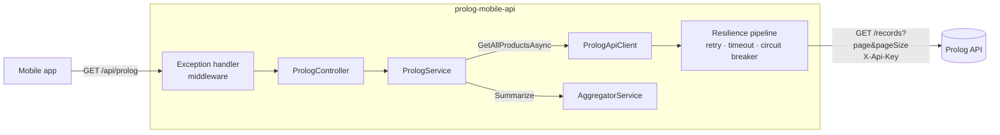
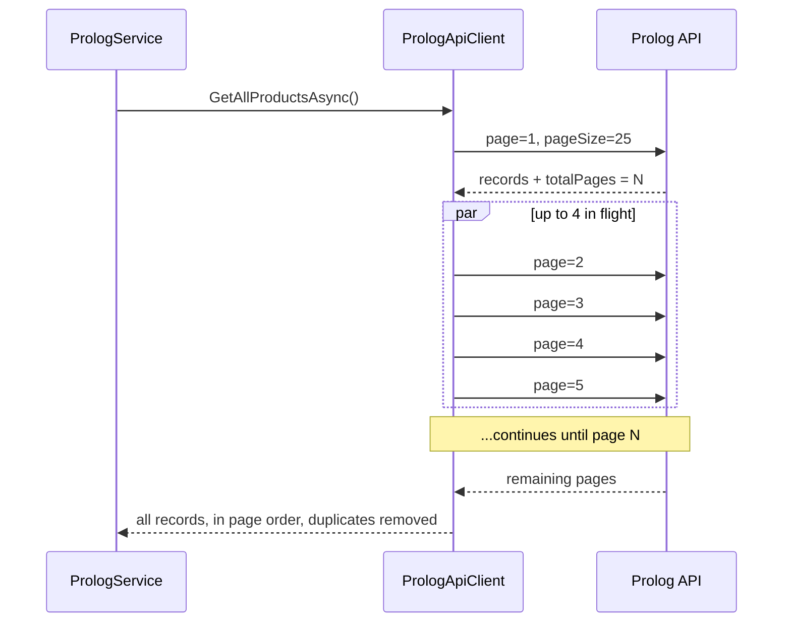

# Architecture

How a request to `GET /api/prolog` flows through the API.

## Request flow

Each layer has one job and knows only about the layer directly below it:

| Layer | File | Responsibility |
|---|---|---|
| Controller | `Controllers/PrologController.cs` | Exposes the HTTP endpoints. No logic. |
| Service | `Services/PrologService.cs` | Orchestration: get all products from the client, hand them to the aggregator. Knows nothing about paging, HTTP or errors. |
| Aggregator | `Services/AggregatorService.cs` | Pure business logic (LINQ): normalise categories, compute totals, pick the most recently updated item. No I/O. |
| Client | `Clients/PrologApiClient.cs` | Everything about talking to the Prolog API: paging, concurrency, mapping failures to `PrologApiException`. |
| Resilience pipeline | `Clients/ClientRegistration.cs` | Retries, timeouts and circuit breaker, added to the `HttpClient`. Also sets the base URL and API key header. |
| Middleware | `Middleware/PrologApiExceptionHandler.cs` | Turns a `PrologApiException` into a ProblemDetails response. |

## Fetching all pages

The client doesn't know how many pages there are until it asks, so the first page is fetched on its
own. Its `totalPages` sets how many more requests to make, and those run concurrently, at most 4 at a time.

The Prolog API allows 5 requests per 10 seconds. When it answers `429 Too Many Requests`, the
resilience pipeline waits for the `Retry-After` delay and retries, so the service never sees it.
That makes a full fetch take about 10 seconds.

## Error flow

Errors are detected in the client and turned into responses by the middleware. Nothing in between
catches them, so the service and controller stay free of error handling.

1. **The resilience pipeline** retries what's worth retrying (429, 408, 5xx, network errors) and
   gives up on the rest (other 4xx, such as a bad API key).
2. **The client** classifies whatever failure is left into a single `PrologApiException`
   with a reason (`Unauthorized`, `RateLimited`, `Timeout`, ...). If any page fails, the whole call
   fails, so partial data never produces wrong totals.
3. **The middleware** maps the reason to a status code (see the error table in
   [README.md](README.md)). The exception's message and stack trace go only to the server log;
   the response carries a generic title, the `reason` and a `traceId` to match it to the log.

Any other unexpected exception becomes a generic `500` ProblemDetails response, also without internal details.

## Configuration

`PrologApiOptions` (`Config/`) binds the `PrologApi` section: `BaseUrl` and `ApiKey` from user
secrets or environment variables, and `Resilience` settings from `appsettings.json`. The options are
validated at startup, so a missing secret stops the app immediately instead of failing on the first request.
